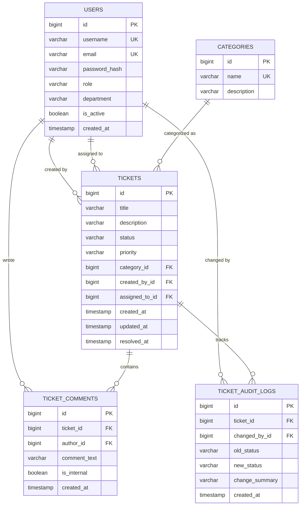

# IT Support Ticket System (Java & SQL Backend)

[](https://openjdk.org/)
[](https://spring.io/projects/spring-boot)
[](https://www.h2database.com/)
[](LICENSE)

Eine objektorientierte Backend-Anwendung zur systematischen Erfassung, Priorisierung und Abwicklung von IT-Support-Tickets in Unternehmen. 

Das Projekt demonstriert den Aufbau einer wartbaren **Schichtenarchitektur (Layered Architecture)** mit moderner Java-Syntax, sauberer relationaler Datenmodellierung in SQL, robuster Geschäftslogik (State Machine für Statuswechsel) und vollständiger Testabdeckung.

---

## 📌 Motivation & Projektziel

In vielen internen IT-Abteilungen gehen Support-Anfragen per Mail oder Chat verloren, Prioritäten sind unklar und es fehlt an nachvollziehbarer Dokumentation. 

Ziel dieses Projekts war die Entwicklung eines leichtgewichtigen, aber produktionsnahen REST-Backends, das:
- Tickets nach **Kategorien** und **Prioritäten** strukturiert,
- **Rollenbasierte Berechtigungen** (`EMPLOYEE`, `SUPPORT_AGENT`, `ADMIN`) durchsetzt,
- Ungültige Statuswechsel verhindert (z. B. Schließen ohne Bearbeiter oder Wiedereröffnen archivierter Tickets),
- Einen lückenlosen **Audit-Log** für jeden Statuswechsel führt.

---

## 🏛️ Architektur & Entwurfsmuster

Die Anwendung folgt einer klaren Trennung von Verantwortlichkeiten (Separation of Concerns):

```
de.ticketsystem
├── config/        # Sicherheitsrichtlinien (BCrypt, Filter Chains) & OpenAPI-Spezifikation
├── domain/        # JPA-Entitäten und Enums (User, Ticket, Category, Comments, AuditLog)
├── dto/           # Java 21 Records für unveränderliche Request-/Response-Modelle
├── repository/    # Spring Data JPA Schnittstellen mit abfrageoptimierten JPQL Queries
├── service/       # Transaktionale Geschäftslogik und Zustandsvalidierung (State Machine)
├── exception/     # Domänenspezifische Exceptions & zentraler GlobalExceptionHandler
└── controller/    # REST API Endpunkte mit Jakarta Bean Validation
```

### Kernmuster im Code
- **DTO-Pattern mit Java 21 Records:** Entitäten werden niemals direkt an den Client exponiert. Request- und Response-Objekte sind als unmodifizierbare Records definiert.
- **State Machine / Zustandsprüfung:** Die Komponente `TicketStateMachine` kapselt alle zulässigen Statusübergänge. Illegale Wechsel (z. B. `CLOSED -> IN_PROGRESS`) werfen eine `InvalidStatusTransitionException` (HTTP 409 Conflict).
- **Zentrales Exception Handling:** Ein `@RestControllerAdvice` fängt domänenspezifische Fehler und Bean-Validierungsfehler ab und liefert einheitliche JSON-Fehlermeldungen.
- **Audit Logging:** Jeder Statuswechsel wird automatisch mit Zeitstempel, ausführendem Benutzer und Begründung in `ticket_audit_logs` archiviert.

---

## 🗄️ Relationales Datenbankschema (SQL)

Das Datenbankschema ist in [schema.sql](src/main/resources/schema.sql) explizit modelliert, um Fremdschlüsselintegrität und Indexierung sauber darzustellen (anstatt sich rein auf ORM-Autogenerierung zu verlassen).



### SQL-Optimierungen & Integrität:
- **Indizes:** `CREATE INDEX idx_tickets_status ON tickets(status)` sowie Indizes auf `assigned_to_id` und `ticket_id` für schnelle Filterung bei wachsender Datenmenge.
- **Kaskadierendes Löschen:** `ON DELETE CASCADE` für Kommentare und Audit-Logs, falls Testdaten bereinigt werden.
- **Referentielle Integrität:** Tickets können nur mit existierenden Kategorien und Benutzern persistiert werden.

---

## 🔄 Ticket-Lebenszyklus (Zustandsdiagramm)

```
        +-----------------------------------+
        |                                   |
        v                                   |
     [OPEN] ----(Zuweisung an Agent)----> [IN_PROGRESS] <----+
        |                                       |            |
        | (Abgelehnt / Duplikat)                |            |
        |                                       +--> [WAITING_FOR_USER]
        |                                       |            |
        |                                       v            |
        +--------------------------------> [RESOLVED] -------+
                                                |
                                                v
                                             [CLOSED] (Endzustand)
```

---

## 🚀 Schnelleinstieg & Ausführung

### Voraussetzungen
- **Java 21** oder neuer
- **Maven 3.8+** (oder Maven Wrapper)

### 1. Repository klonen & kompilieren
```bash
git clone https://github.com/AdamBakashev/it-support-ticket-system.git
cd it-support-ticket-system
mvn clean package
```

### 2. Tests ausführen
```bash
mvn test
```
*Führt sowohl die Mockito-Unit-Tests für die Geschäftslogik als auch die MockMvc-Integrationstests für alle HTTP-Endpunkte aus.*

### 3. Anwendung starten
```bash
mvn spring-boot:run
```

Die Anwendung startet standardmäßig auf Port `8080`.

---

## 🖥️ Interaktive Oberflächen

Nach dem Start stehen folgende Endpunkte zur Verfügung:

| Oberfläche | URL | Beschreibung |
|---|---|---|
| **Swagger UI** | [http://localhost:8080/swagger-ui.html](http://localhost:8080/swagger-ui.html) | Interaktive REST API Dokumentation & Testen aller Endpunkte |
| **OpenAPI JSON** | [http://localhost:8080/api-docs](http://localhost:8080/api-docs) | OpenAPI 3.0 Spezifikation |
| **H2 Datenbank-Konsole** | [http://localhost:8080/h2-console](http://localhost:8080/h2-console) | JDBC-URL: `jdbc:h2:mem:ticketdb`, User: `sa`, Passwort: *(leer)* |

---

## 📡 Wichtigste REST-Endpunkte

| Methode | Pfad | Beschreibung |
|---|---|---|
| `GET` | `/api/v1/tickets` | Alle Tickets abrufen (Filter: `?status=OPEN&priority=HIGH`) |
| `GET` | `/api/v1/tickets/{id}` | Ticket-Details inkl. Kommentare & Revisionshistorie |
| `POST` | `/api/v1/tickets` | Neues Ticket anlegen |
| `PATCH` | `/api/v1/tickets/{id}/status` | Status ändern (geprüft durch State Machine) |
| `POST` | `/api/v1/tickets/{id}/assign` | Ticket einem Support-Agenten zuweisen |
| `POST` | `/api/v1/tickets/{id}/comments` | Öffentlichen Kommentar oder interne Notiz hinzufügen |
| `GET` | `/api/v1/users` | Benutzerübersicht |
| `POST` | `/api/v1/users` | Neuen Benutzer anlegen (Passwort wird mit BCrypt gehasht) |
| `GET` | `/api/v1/categories` | Support-Kategorien auflisten |

---

## 💡 Technische Überlegungen & Designentscheidungen

*(Nützliche Punkte für Rückfragen im Fachinterview)*

1. **Warum explizites `schema.sql` statt reinem Hibernate `ddl-auto: update`?**  
   Im professionellen Umfeld wird das Datenbankschema versioniert (z. B. mit Flyway/Liquibase). Durch explizites SQL behält man die volle Kontrolle über Datentypen, Indizes und Constraints und versteht die zugrundeliegende relationale Struktur.

2. **Warum Java Records für DTOs?**  
   Records garantieren Immutability (Unveränderlichkeit) und reduzieren Boilerplate-Code (kein manueller Getter/Equals/HashCode-Code). Sie sind seit Java 16 Standard und eignen sich perfekt als Transportobjekte.

3. **Wie wird Datenkonsistenz bei Statuswechseln gesichert?**  
   Durch die Annotation `@Transactional` auf Service-Ebene wird sichergestellt, dass Statusänderung, Zeitstempel-Aktualisierung und das Schreiben des Audit-Logs atomar in einer Datenbanktransaktion erfolgen. Schlägt ein Schritt fehl, wird die gesamte Operation zurückgerollt.

4. **Sicherheit:**  
   Passwörter werden niemals im Klartext gespeichert, sondern mit `BCryptPasswordEncoder` mit adaptivem Work-Factor gehasht.

---

## 🔮 Geplante Erweiterungen (Roadmap)
- [ ] Integration von Flyway für versionierte Datenbankmigrationen
- [ ] JWT-basierte Authentifizierung (Bearer Token)
- [ ] E-Mail-Benachrichtigung bei Ticket-Zuweisung via Spring Mail / SMTP
- [ ] Docker Compose Setup für einfaches Umschalten auf PostgreSQL
